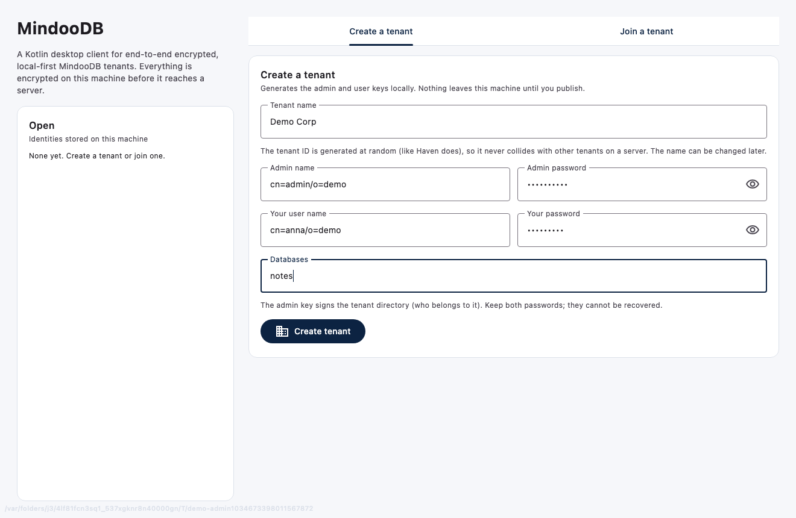
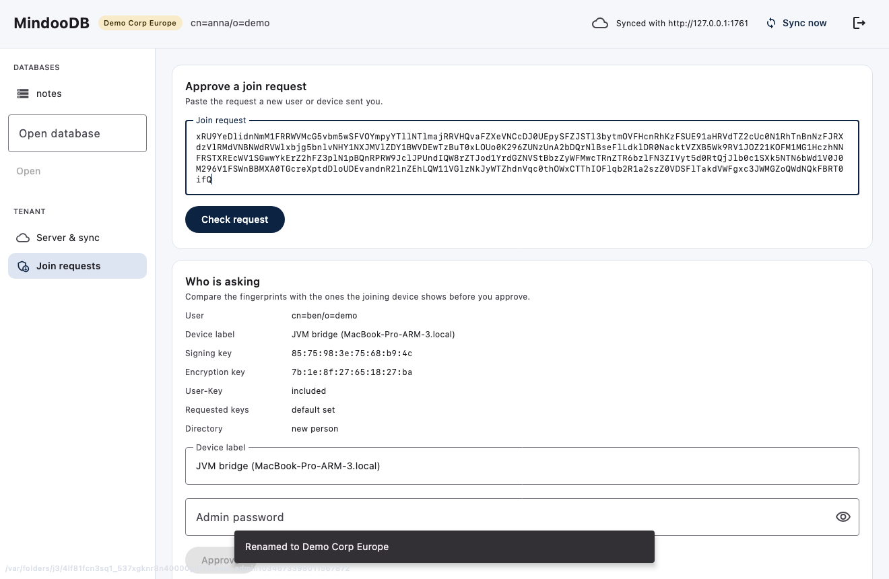
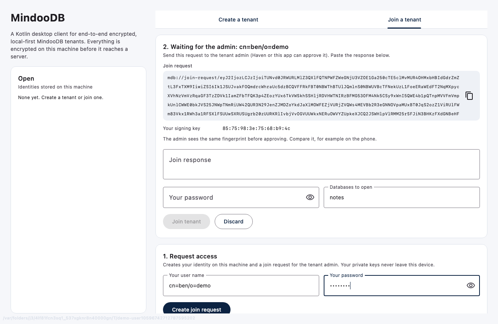
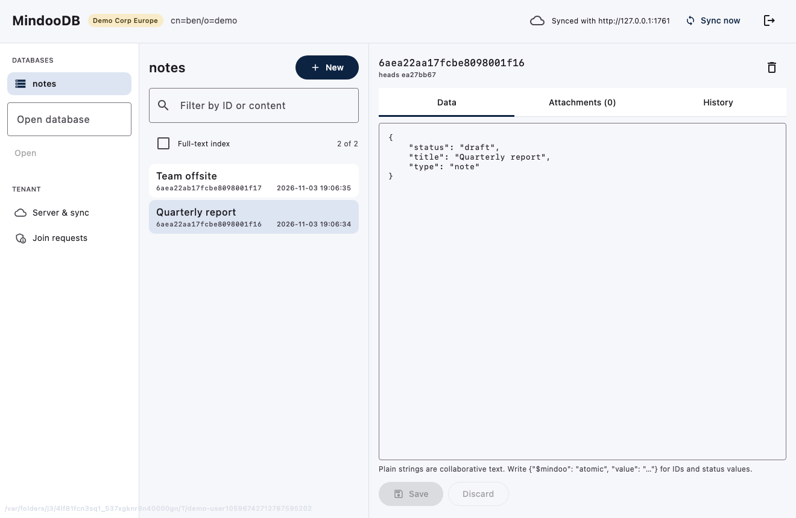
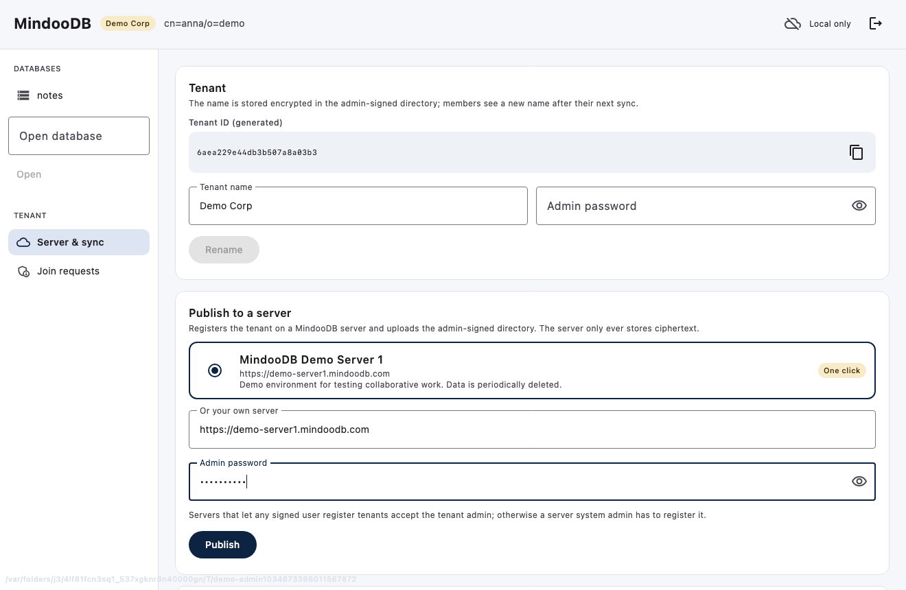
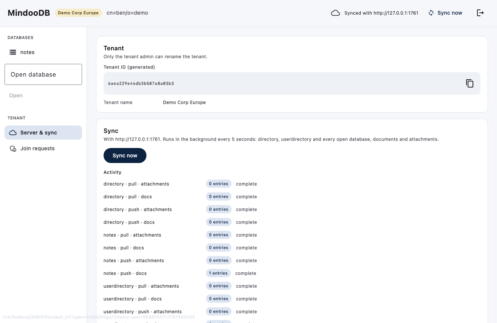

# MindooDB Kotlin Demo

A Compose Desktop app that uses the [MindooDB Kotlin client](https://github.com/klehmann/mindoodb-kmp-client) the way Haven uses MindooDB: create a tenant on your machine, publish it to a server, let others join, and browse and edit the encrypted documents.

It is a demo, and a test of the Kotlin API: every screen uses only the public client API.

| Admin: create a tenant | Admin: check a join request |
|---|---|
|  |  |
| **New user: waiting for the admin** | **New user: the admin's documents** |
|  |  |
| **Admin: publish (demo server preselected)** | **Sync activity** |
|  |  |

## What it does

- **Start:** create a tenant with a name of your choice (the tenant ID is generated at random like in Haven, so it never collides on a shared server; admin and user keys are generated locally), request access to an existing tenant (shows your join request and your key fingerprint), or open an identity stored on this machine.
- **Tenant:** the admin renames the tenant; the name is stored encrypted in the admin-signed directory, and members see it after their next sync.
- **Server & sync:** publish the tenant to a MindooDB server, or connect a joined tenant. The MindooDB demo server that Haven offers (`https://demo-server1.mindoodb.com`, data is deleted periodically) is preselected, so you can start with one click; any other server URL works too. Sync runs in the background every 5 seconds; "Sync now" syncs right away. The activity list and the progress bar in the title bar come from `session.syncProgress()`.
- **Join requests (admin):** paste a request, check who asks (name, device label, key fingerprints, whether the person or device is already in the directory), approve, and send the response back.
- **Documents:** a live list per database (`liveQuery`, follows local changes and sync), filter or full-text search, a JSON editor to create, change and delete documents (changes are merged at the version you edited), attachments (upload, download, remove) and the revision history.

## Run it

You need JDK 21+ and Node.js 22.13+. Clone the three projects next to each other and build the sidecar:

```bash
git clone https://github.com/klehmann/mindoodb-jvm-bridge.git
git clone https://github.com/klehmann/mindoodb-kmp-client.git
git clone https://github.com/klehmann/mindoodb-kmp-demo.git

cd mindoodb-jvm-bridge && npm install && npm run build && cd ..
cd mindoodb-kmp-demo
./gradlew run
```

Arguments (pass them with `./gradlew run --args="…"`):

| Argument | Default | |
|---|---|---|
| `--data <dir>` | `./demo-data` | identities, replicas, `profiles.json` (no passwords) |
| `--bridge <file>` | `../mindoodb-jvm-bridge/dist/index.js` | the sidecar entry point |
| `--title <text>` | `MindooDB Kotlin Demo` | window title |
| `--theme dark` | light | dark color scheme |

### Two users on one machine

Start a local MindooDB server that lets any signed user register tenants (test setup only):

```bash
MINDOODB_SERVER_PASSWORD=test node ../mindoodb-jvm-bridge/node_modules/mindoodb/dist/node/server/serverinit.js \
  --name cn=testserver/o=test --skip-admin -d /tmp/mdb-server
cat > /tmp/mdb-server/config.json <<'JSON'
{ "capabilities": { "POST:/system/tenants/*": [{ "username": "*", "publicsignkey": "*" }] } }
JSON
MINDOODB_SERVER_PASSWORD=test node ../mindoodb-jvm-bridge/node_modules/mindoodb/dist/node/server/server.js -d /tmp/mdb-server -p 1761
```

Then run two instances with separate data directories:

```bash
./gradlew run --args="--data demo-data-anna --title Anna"
```

```bash
./gradlew run --args="--data demo-data-ben --title Ben"
```

Anna creates a tenant and publishes it, to the demo server with one click or to `http://127.0.0.1:1761` under "Or your own server". Ben requests access and sends Anna the request. Anna checks it under "Join requests" (the signing key fingerprint is the one Ben's window shows), approves, and sends the response back. Ben pastes it and sees Anna's documents. Haven can take either role: it approves requests from this app, and this app approves requests from Haven.

## Test

`WalkthroughTest` drives exactly this flow through the UI of two app instances against a server and saves a screenshot of each step to `build/screenshots`:

```bash
MINDOODB_TEST_SERVER_URL=http://127.0.0.1:1761 ./gradlew test
```

Without `MINDOODB_TEST_SERVER_URL` the test is skipped.

## Notes

- The Kotlin client and the sidecar are beta; their APIs may still change.
- The sidecar holds each user's decrypted keys in its own child process and listens on loopback only. Passwords are used to open a session and are not stored.
- Plain strings in documents are collaborative text. For IDs and status values write `{"$mindoo": "atomic", "value": "…"}` in the editor.
